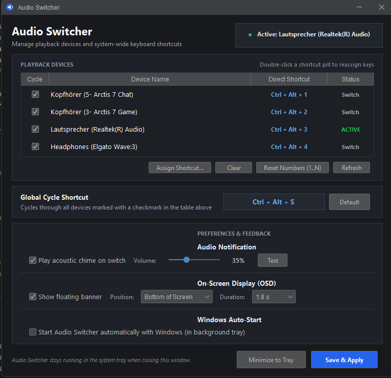

<div align="center">

# Audio Switcher

[](https://github.com/roemertimon/audio-switcher/actions/workflows/build.yml)   [](LICENSE)

</div>

**Audio Switcher** is a lightweight Windows desktop application for switching audio playback devices using system-wide keyboard shortcuts. It lets you cycle through selected audio outputs or jump directly to a specific device with dedicated numbered shortcuts, accompanied by an optional on-screen display banner and an acoustic chime.

## Features

- Cycle sequentially through enabled playback devices with a global shortcut (`Ctrl + Alt + S`).
- Switch directly to any output using auto-assigned hotkeys (`Ctrl + Alt + 1` through `Ctrl + Alt + 9`).
- Play a gentle acoustic chime directly through the newly activated device, with an adjustable volume slider.
- Display a floating On-Screen Display (OSD) banner with adaptive icons for headphones and speakers.
- Filter which devices are included in the cycle sequence to ignore unused or virtual outputs.
- Native Windows CoreAudio COM integration via JNA without background command windows or external helper executables.
- Stays available in the Windows notification area (system tray) with a one-click device selection menu.
- Single-instance guard brings the existing window to the front if launched again.
- Optional automatic start on Windows login.

## Screenshots

<p align="center">
  
</p>

## Getting started

### Requirements

- Windows 10 or Windows 11 (64-bit)
- [Java Development Kit (JDK) 17](https://adoptium.net/) or newer

### Build and run

Clone the repository and run the application from its root directory using the Gradle wrapper:

```powershell
git clone https://github.com/roemertimon/audio-switcher.git
cd audio-switcher
.\gradlew.bat run
```

To build a standalone executable fat JAR:

```powershell
.\gradlew.bat fatJar
```

The output file is generated at `build/libs/audio-switcher-1.0.0-all.jar`. It includes all runtime dependencies and can be run directly with:

```powershell
java -jar build\libs\audio-switcher-1.0.0-all.jar
```

Run the automated test suite with:

```powershell
.\gradlew.bat test
```

## Using Audio Switcher

### Switching playback devices

Audio Switcher offers three ways to switch playback devices:

1. **Global cycle shortcut**: Press `Ctrl + Alt + S` (customizable) to switch to the next device that has **Cycle** checked in the table.
2. **Dedicated shortcuts**: Each device is automatically assigned a number shortcut (`Ctrl + Alt + 1`, `Ctrl + Alt + 2`, etc.) when first detected. Pressing the combination switches directly to that device from any application or game.
3. **System tray menu**: Right-click the speaker icon in the Windows notification area and click any device to switch immediately.

### Customizing shortcuts

To reassign a device shortcut, double-click its pill in the **Direct Shortcut** column, or select the row and click **Assign Shortcut...**. Press your desired key combination in the dialog and click **Save Shortcut**.

To restore the default sequential numbering (`Ctrl + Alt + 1..N`), click **Reset Numbers (1..N)**.

### Feedback and display

- **Audio Notification**: When enabled, Audio Switcher synthesizes a short harmonic chime and plays it through the target audio endpoint right after the switch occurs. Adjust the volume slider to taste, and click **Test** to preview the sound at that volume.
- **On-Screen Display (OSD)**: Displays a floating banner with the device name and icon for a configurable duration (1.0 to 3.0 seconds). The screen position can be set to the top, center, or bottom of the primary display.

### Windows auto-start

Tick **Start Audio Switcher automatically with Windows** and click **Save & Apply**. Audio Switcher registers a value in `HKCU\Software\Microsoft\Windows\CurrentVersion\Run` and will start minimized in the system tray on boot.

## Project structure

```text
audio-switcher/
├── .github/workflows/           GitHub Actions CI workflow
├── docs/screenshots/           Application screenshots
├── src/main/java/com/audioswitcher/
│   ├── audio/
│   │   ├── AudioDeviceManager.java   Device enumeration, state, and cycle logic
│   │   ├── SoundNotifier.java        Acoustic chime synthesizer and player
│   │   └── WindowsCoreAudio.java     JNA COM bindings to CoreAudio & IPolicyConfig
│   ├── config/
│   │   ├── AppConfig.java            Configuration data model
│   │   └── ConfigManager.java        JSON config persistence in %APPDATA%
│   ├── hotkey/
│   │   └── HotkeyManager.java        Win32 RegisterHotKey message loop
│   ├── model/
│   │   └── AudioDevice.java          Audio endpoint model
│   ├── startup/
│   │   └── StartupManager.java       Windows Registry auto-start manager
│   ├── ui/
│   │   ├── OsdOverlay.java           Floating on-screen display banner
│   │   ├── SettingsFrame.java        Main dashboard and preferences window
│   │   └── TrayManager.java          System tray icon and context menu
│   └── AudioSwitcherApp.java         Application entry point and lifecycle
├── src/test/java/               Unit tests for device enumeration
├── build.gradle                 Gradle build script and dependencies
├── settings.gradle              Gradle project settings
└── gradlew.bat                  Gradle wrapper executable
```

## Built with

- Java 17+ and Swing with [FlatLaf](https://www.formdev.com/flatlaf/) for the modern dark theme
- [JNA (Java Native Access)](https://github.com/java-native-access/jna) for the Win32 API (`RegisterHotKey`, Windows Registry, Named Mutex) and CoreAudio COM interfaces (`IMMDeviceEnumerator`, `IPolicyConfig`)
- [Gson](https://github.com/google/gson) for JSON configuration storage in `%APPDATA%\JavaAudioSwitcher\config.json`
- [JUnit 5](https://junit.org/junit5/) for the test suite
- Gradle for build automation

## License

This project is licensed under the [MIT License](LICENSE). You are free to use, modify, and distribute it. See the [LICENSE](LICENSE) file for details.
